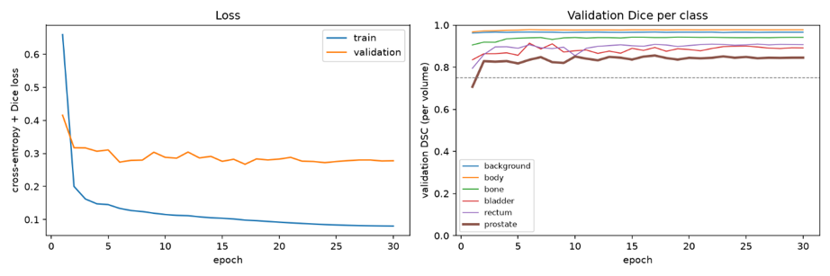
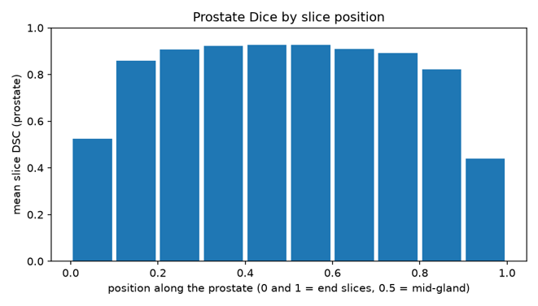
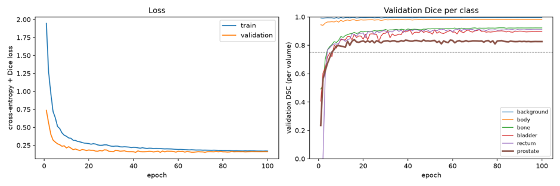
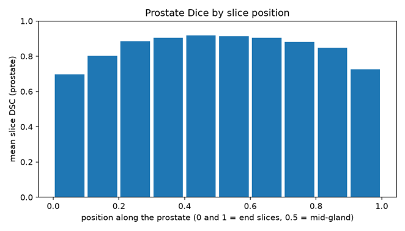
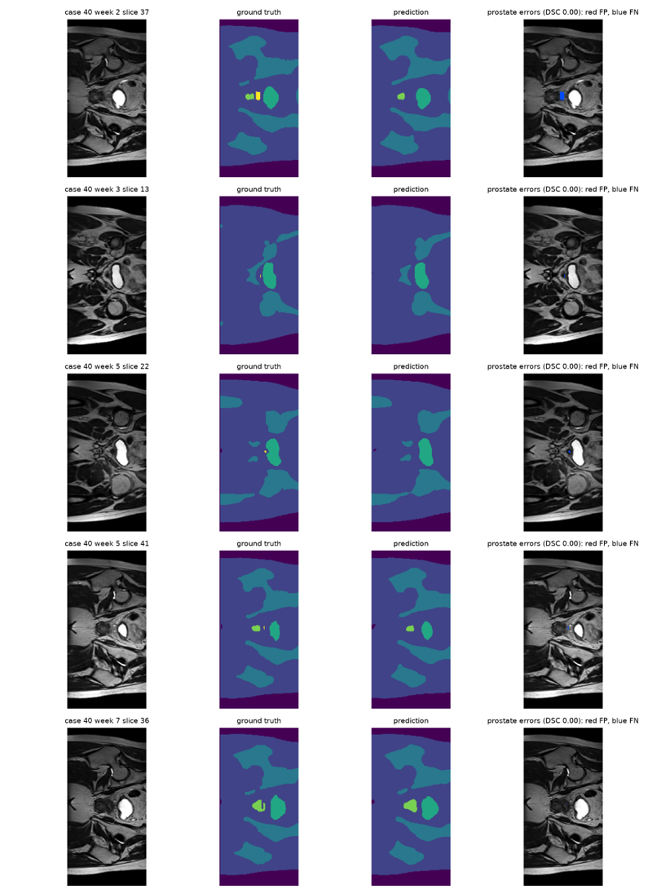
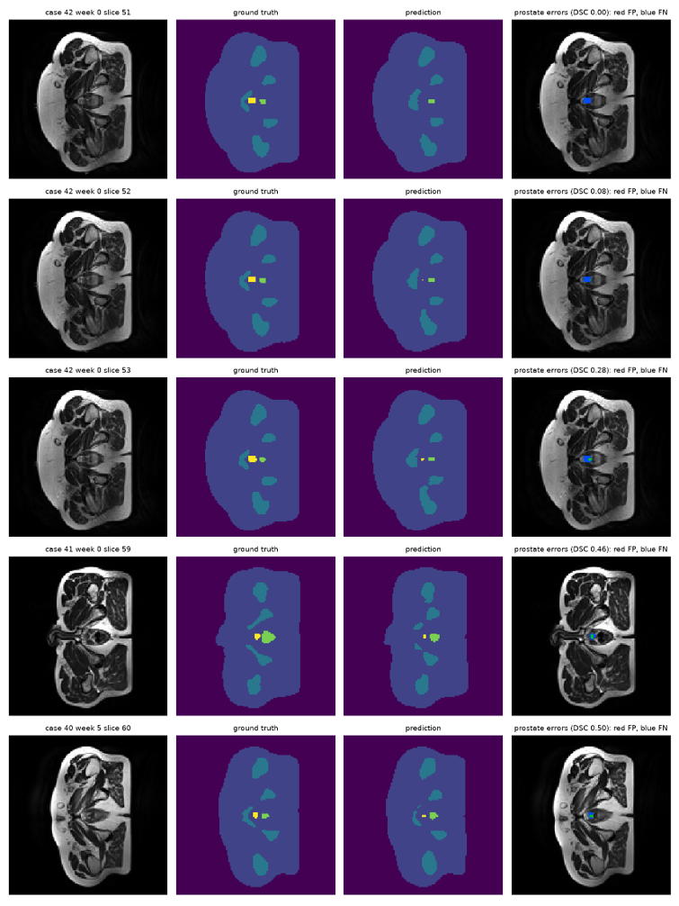

# Prostate Radiotherapy Contouring on HipMRI: Evaluating a 3D Improved U-Net Against a 2D Baseline on Boundary and Slice-Transition Errors

**Emma Barnett | 48028293**

---

### Reproducibility

- **Data split:** The provided HipMRI train/validate/test split (31/4/3 patients) is used. The 3D volumes follow the same patient-level split as the 2D slices, and a leakage check confirms no patient appears in more than one split.
- **Seeding:** All runs use `--seed 42`, which seeds PyTorch, NumPy and the data augmentation. The seed is saved in each checkpoint.
- **Saved outputs:** Each run saves its best checkpoint, training history and test report to `runs/<model>/`.
- **Limitation:** Some GPU operations (e.g. 3D convolution backward passes) are non-deterministic, so repeated runs with the same seed may differ slightly in final Dice scores.

### Usage

```bash
# Train (also evaluates the best checkpoint on the test split)
python train.py --model unet2d
python train.py --model improved_unet3d

# Predict: per-volume/per-slice metrics, Dice-by-position plot, failure cases
python predict.py --model unet2d
python predict.py --model improved_unet3d
```

---

## 1. Introduction

This project investigates whether a 3D Improved U-Net machine learning model can eliminate hazardous boundary and slice-transition errors compared with a standard 2D baseline in prostate radiotherapy planning. This investigation will utilise the HipMRI dataset, a set of 211 3D MRI scans collected from 38 prostate cancer patients.

A 2D U-Net will be used as a baseline for model evaluation. The 2D U-Net is widely used for image segmentation, particularly in medical imaging research. The model accepts a single 2D MRI slice as its input and outputs a segmented image, with each pixel mapped to a predicted class. The architecture is symmetrical, consisting of an encoder, a bottleneck, a decoder and skip connections between matching encoder and decoder levels.

A 3D Improved U-Net will be investigated and evaluated against the baseline. This neural network model will use a down sampled version of the HipMRI 3D data, with the following key features: pre-activation residual blocks, strided-convolution downsampling, instance normalisation, Leaky ReLU activation function, channel-wise 3D dropout (Dropout3d) and deep supervision.

The 3D Improved U-Net aims to address existing limitations of the 2D U-Net model. The improved algorithm aims to achieve an acceptable global Dice score (≥0.70) across wide central slices, but also across challenging local boundary failure regions such as the superior (base) and inferior (apex) slices. Over-contouring these regions (i.e. false positive classification of prostate) can lead to severe radiation toxicity, whilst under-contouring (i.e. false negative classification of prostate) introduces potential cancer recurrence.

This project also aims to provide recommendations on whether the improved model provides measurable clinical benefits for the additional computational budget required.

---

## 2. Feasibility Review

### User Need, Scope & Acceptance Criteria

The purpose of this project is to investigate how effectively a 3D U-Net and 3D Improved U-Net eliminate hazardous boundary and slice transition errors on the HipMRI dataset, compared with a standard 2D U-Net baseline. The intended users are imaging health specialists who contour the prostate for radiotherapy planning. The prototype proposes an anatomical contour for the specialist to review and adjust, aiming to save contouring time while delivering a high level of boundary accuracy at the prostate base and apex, where errors are most harmful. The following testable acceptance criteria for the investigation are:

- 2D U-Net reaches prostate Dice ≥ 0.75 on held out test split
- 3D U-Net and 3D Improved U-Net reaches prostate Dice ≥ 0.70
- Inspection of boundary failures cases, specifically prostate base and apex slices, verifying 3D models perform better than 2D baseline.

### Model Choice & Course Concepts

The HipMRI dataset for prostate cancer radiotherapy will be used. This dataset consists of 38 patients, with 211 3D MRI volumes. The data will be split based on the existing training, validation and testing sets. Data preprocessing will be completed to enforce strict patient-level splitting, standardized intensity normalisation and one-hot multi-channel mask encoding. The following model architectures, with varying difficulty, will be investigated:

| Model             | Difficulty | Data                       | Architecture                                                                                                                     |
| ----------------- | ---------- | -------------------------- | -------------------------------------------------------------------------------------------------------------------------------- |
| 2D U-Net          | Easy       | HipMRI 2D slices           | Encoder-decoder with skip connections and 2D convolutions                                                                        |
| 3D U-Net          | Normal     | Downsampled HipMRI 3D data | Encoder-decoder with skip connections and 3D convolutions                                                                        |
| 3D Improved U-Net | Hard       | Downsampled HipMRI 3D data | 3D U-Net with pre-activation residual blocks, dropout layers, instance normalization, and deep supervision in localisation path. |

Course concepts such as U-Net, convolutional layers, skip connections, residual learning and Dice loss will be utilised to construct these models. Appropriate data splitting and normalisation will also be performed in alignment with course concepts.

### Preliminary Feasibility Evidence

Early implementation of the 2D U-Net baselines has already been implemented and has successfully achieved a mean prostate Dice of 0.877 on the held-out test set (9 volumes from 3 patients), satisfying the target of ≥0.75. The model ran for 30 epochs and trained for 15 minutes on the A100 GPU, with a peak training memory of 3.4 GB. Inference required 1.4 G of GPU memory and approximately 0.05-0.08 seconds per case. This confirms the data pipeline, patient-level splitting and evaluation code are working correctly and establishes the baseline for the 3D models.

### Risks, Budget & Fallback

The following risks have been identified:

- Limited dataset size, with only 38 patients this could limit the potential learning
- Potential class imbalance if the prostate is only small percentage of the scans
- Potential patient data leakage due to the same patient appearing in both the training and test sets
- Challenging score comparison between 2D and 3D models.
- Rangpur GPU testing delays, due to high student demand.
- More complex 3D models exceed GPU memory

The next planned experiment is to move to the Normal difficulty 3D U-Net model.

---

## 3. Data Pre-Processing

Prior to completing any training, the 2D and 3D datasets were analysed to review the existing data format, data splits, class balance and whether any leakage was present.

The following information was found:

**Table 1: Data processing results**

|                   | 2D dataset                                                                                   | 3D dataset                                                                                   |
| ----------------- | -------------------------------------------------------------------------------------------- | -------------------------------------------------------------------------------------------- |
| **Data Format**   | 211 scans across 38 patients, 60 slices per scan                                             | 211 scans across 38 patients, 128 axial slices per scan.                                     |
| **Data Split**    | Existing train/validate/test split is 31/4/3 patients. This is equivalent to 191/11/9 scans. | Existing train/validate/test split is 31/4/3 patients. This is equivalent to 191/11/9 scans. |
| **Class Balance** | Body 67.5%, Background 17.3%, Bone 12.5%, Bladder 1.9%, Prostate 0.43%, Rectum 0.36%         | Background 60.5%, Body 35.4%, bone 3.4%, bladder 0.57%, rectum 0.14%, Prostate 0.10%         |
| **Data Leakage**  | No leakage detected                                                                          | No leakage detected                                                                          |
| **Test set**      | Identical tests sets, containing cases 40, 41 and 42                                         | Identical tests sets, containing cases 40, 41 and 42                                         |

This information suggests that the existing train, validation, test split is acceptable for the 2D and 3D U-Net models. The 2D split provided was used as a base for splitting the 3D dataset identically for accurate model comparison. Both sets recorded no data leakage, identical test sets and an appropriate split, with approximately 90% of scans in the training set, 5% in the validation set and 5% in the testing set. Therefore, no further data splitting or patient-level splitting is required.

The data processing pipeline used for the 3D Improved U-Net is as follows:

1. Match the images to their label, patient and week number
2. **Splitting:** Split the 3d dataset in accordance with the 2D splitting, i.e. 31/4/3 patient level split.
3. **Down sampling:** Down sample each image and label to (2,2,1).
4. **One-Hot Encoding:** The labels were converted to 6 one-hot channels
5. **Normalisation:** Each scan has been normalised such that every scan has a mean of 0 and a standard deviation of 1.

---

## 4. Model

The 3D Improved U-Net model uses the following features to improve its performance:

- Residual context modules are used to add the input back into the output, so gradients flow through the shortcut, and each block learns a refinement.
- Strided 3x3x3 convolution used to down sample the information in the encoder block
- A Leaky ReLU activation function with slope of 0.01.
- 3D dropout randomly drops whole feature channels during training to reduce overfitting to the training dataset.
- Deep supervision segmentation maps from three decoder levels are upsampled and summed into the final output.

The following training settings have been used:

- 100 epochs used for training, 2 scans per batch
- Adam optimiser used to adapt the step size for each weight
- Learning rate of 1×10⁻³
- Class weightings increased for the prostate specifically, allowing the model to focus on learning the prostate features.
- Loss function combining cross entropy and of multi-class Dice, with the prostate weighted three times the Dice term so the model focuses on the smallest, clinically critical class.
- Training-only augmentation applied. Incudes random in-plane rotation (±10°), scaling (±10%), translation (±5%), and contrast and brightness changes (±10%), applied identically to the image and labels, to increase the variety of training examples and reduce overfitting.

---

## 5. Evaluation Metrics

The main evaluation metric being used is the prostate DSC score of the superior (base) and inferior (apex) slices. Additional metrics include the training curves, peak GPU VRAM, per-case inference time, and error cases recorded.

---

## 6. Results

### 2D U-Net Baseline

The 2D U-Net baseline model produced the following results (refer to Appendix 8.1 for failure cases). The model trained in 17.1 mins, with an average inference time of 0.048s. The training curves in Figure 1 indicate that the model training was most successful in the early epochs of training, and the validation loss stabilised at approximately 0.3 as the training curve continued to improve, suggesting possible overfitting on the training dataset. However. The validation Dice scores per class increased during the early epochs and then stabilised.

Figure 2 is the most critical measure of the models baseline performance for this investigation, with a focus on the end slices located in bins 0 and 9, as these are the superior and inferior prostate MRI slices, where over and under-contouring of the prostate can occur. The first slice recorded a prostate Dice score of 0.524, and the last slice a prostate Dice score of 0.440. An average Dice score of 0.885 was recorded for the prostate across all slices, indicating the model was poor at correctly predicting the prostate class on the end slice locations specifically.



_Figure 1: Baseline Loss and Validation DSC scores_



_Figure 2: Baseline Prostate Dice by Slice Position_

### 3D Improved U-Net

In comparison, the 3D Improved U-Net model produced the following results (refer to Appendix 8.1 for failure cases). The model trains in 22.6 minutes, with an average inference time of 0.018 seconds. Figure 3 depicts the training curves for the model and indicates improved performance, with the training and validation loss curves both decreasing substantially as the epochs continue. Similarly, the validation Dice scores per class during training suggest efficient training across all the different classes.

Figure 4 demonstrates the prostate Dice scores across each MRI slice, with an average score of 0.873 recorded. The apex slice had a Dice score of 0.697, and the base slice a Dice score of 0.725. These scores indicate a strong improvement in model performance at the superior and inferior slices, with the 3D Improved U-Net model being more effective at correctly classifying the prostate pixels at these challenging locations than the baseline model.



_Figure 3: Improved 3D-Unet Loss and Validation DSC scores_



_Figure 4: Improved 3D-Inet Prostate Dice by Slice Position_

### Computational Comparison

The computational efficiency metrics are compared below in Table 2. They indicate that the improved model has a higher computational cost, requiring more training time and more peak VRAM. However, this increase in computational cost is expected, given that the improved model performs 3D convolutions, with substantially more activations stored per forward pass.

**Table 2: Computational Metric Comparison**

|                         | 2D Baseline | Improved 3D U-Net Model |
| ----------------------- | ----------- | ----------------------- |
| Training Time           | 17.1 min    | 22.6 min                |
| Peak VRAM Training      | 3465 MiB    | 4260 MiB                |
| Peak VRAM Inference     | 1454 MiB    | 1729 MiB                |
| Inference Time per case | 0.048 s     | 0.018 s                 |

### Dice by Slice Position

The prostate Dice by position is compared below in Table 3.

**Table 3: DSC Scores compared by slice position**

| Bin      | Position | 2D Baseline mean DSC | 3D Improved mean DSC | Difference (3D − 2D) | Region    |
| -------- | -------- | -------------------- | -------------------- | -------------------- | --------- |
| 0        | 0.0–0.1  | 0.524                | 0.697                | +0.173               | Apex end  |
| 1        | 0.1–0.2  | 0.860                | 0.803                | -0.057               |           |
| 2        | 0.2–0.3  | 0.906                | 0.886                | -0.020               |           |
| 3        | 0.3–0.4  | 0.921                | 0.905                | -0.016               |           |
| 4        | 0.4–0.5  | 0.927                | 0.918                | -0.009               | Mid-gland |
| 5        | 0.5–0.6  | 0.926                | 0.913                | -0.013               | Mid-gland |
| 6        | 0.6–0.7  | 0.910                | 0.905                | -0.005               |           |
| 7        | 0.7–0.8  | 0.891                | 0.881                | -0.009               |           |
| 8        | 0.8–0.9  | 0.823                | 0.848                | +0.025               |           |
| 9        | 0.9–1.0  | 0.440                | 0.725                | +0.285               | Base end  |
| **Mean** |          | **0.885**            | **0.873**            | **-0.012**           |           |

Table 3 indicates that the 3D Improved U-Net performed better compared to the baseline at prostate classification at the challenging base and apex slices. The model recorded an improved average performance of 0.173 at the apex slice and 0.285 at the base. A very slight reduction in performance was recorded in the remaining central slices. This improvement constitutes a significant benefit, with the 3D Improved U-Net greatly eliminating false positive and false negative prostate classification at these hazarding boundary and slice transitions. However, the model does demonstrate some slight smoothing of the central slices.

### Failure Cases

Five of the specific boundary failure cases for the prostate can be reviewed in Appendix 8.2. These five failures are the prostate slices with the lowest Dice scores across all the test scans. The images compare the input image, ground truth mask, predicted mask and an error overlay with false positives in red and false negatives in blue. These five worst failure causes demonstrate a consistent under-contouring of the prostate at the apex specifically. All five cases were false negatives at the prostate apex. Three were consecutive slices from one patient (case 42, slices 51–53), with the remaining two from cases 41 and 40 (slices 59 and 60).

Therefore, whilst the model has demonstrated an improvement in prostate identification at these boundary failure regions, the model still recorded some false negative identifications. This indicates a reduced, but still ongoing risk of under-contouring and therefore introduces a potential risk of cancer recurrence.

---

## 7. Conclusions

Therefore, this investigation suggests that in prostate radiotherapy planning, the 3D Improved U-Net model provides a substantial improvement in the standard global Sorensen-Dice similarity coefficients, with significant improvement in performance at superior (base) and inferior (apex) slices. The baseline and improved 3D model recorded similar Dice scores on the prostate label on the test set, exceeding the target Dice scores of ≥0.75 for the baseline mode, and ≥0.70 for the improved model.

However, most notably, the baseline model recorded 0.525 and 0.440 Dice scores at the critical boundary slices, whilst the 3D improved model recorded Dice scores of 0.697 and 0.725. This is a significant improvement in performance at these hazardous boundary slices. Whilst the baseline model greatly over and under contours the prostate region, the 3D model is able to accurately delineate the prostate from other critical organs at risk.

The 3D Improved U-Net delivers a measurable clinical gain in identifying the prostate, and despite an increase in GPU memory and training time, the improvement outweighs the additional computational budget.

---

## 8. Appendices

### Appendix 8.1: Failure Cases for Base Model



### Appendix 8.2: Failure Cases for Improved U-Net Model



---

## 9. Artificial Intelligence Usage Disclosure

**AI Tool Used:** Claude

**What specific tasks AI assisted with:**

AI was used to suggest code on how to extend my existing 2D U-Net to a 3D and improved 3D U-Net model. It was also used to debug errors and help format the README file

**How you audited, verified and empirically tested the AI suggested code:**

I reviewed all suggested code, confirming the patient-level split, leakage and U-Net model structure. I made changes gradually, testing each improvement before moving on to ensure the code was working correctly. The experimental design, analysis and conclusions were completed independently of AI.
